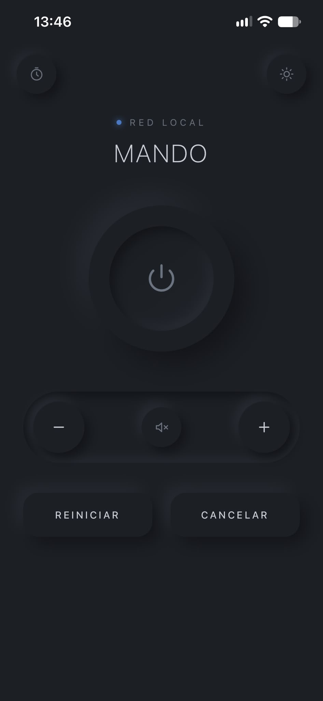
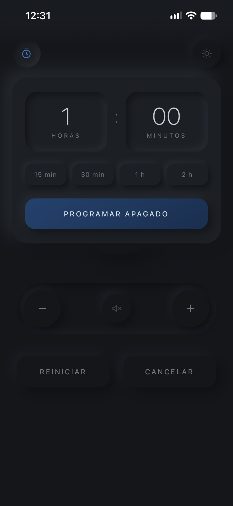
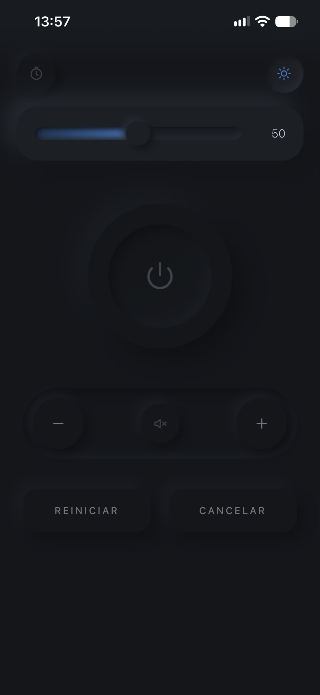

# MANDO

Mando a distancia para un PC con Windows 11 desde el iPhone (o cualquier móvil), a través de la wifi de casa.
Una página web servida por el propio PC.


## DEMO
<div align="center">
  
  &nbsp;&nbsp;
  
  &nbsp;&nbsp;
  
</div>


## Funciones

- **Apagar** y **reiniciar** con 30 s de margen y cuenta atrás en pantalla.
- **Cancelar** un apagado o reinicio pendiente.
- **Volumen**: subir, bajar (mantener pulsado repite) y silenciar.
- **Brillo del monitor** por DDC/CI, con barra deslizante que se abre en el valor real.

Solo usa la librería estándar de Python: no hay que instalar dependencias.

## Archivos

| Archivo | Para qué sirve |
|---|---|
| `apagar_pc.py` | El servidor y la página web. |
| `mando_app.py` | App de escritorio: arranca el servidor y muestra la dirección (con QR) en una ventanita. |
| `construir.ps1` | Genera `Mando.exe` a partir de los dos anteriores (para pasárselo a alguien sin conocimientos). |
| `crear_accesos.ps1` | Crea los accesos directos de Iniciar y Detener en el escritorio. |
| `token.txt` | Se genera solo la primera vez. Es la clave de acceso. **No se sube al repo.** |

## Requisitos

- Windows 10 u 11.
- Python 3.8 o superior, con **"Add Python to PATH"** marcado al instalarlo.
- Para el brillo: monitor con **DDC/CI** activado en su menú (si Twinkle Tray funciona, ya lo está).
- El móvil y el PC en la misma red wifi.

## Instalación en un PC nuevo

### 1. Descargar el proyecto

```powershell
cd $HOME
git clone https://github.com/<tu-usuario>/mando.git
cd mando
```

### 2. Probarlo y obtener la URL

```powershell
python apagar_pc.py
```

La primera vez crea `token.txt` y muestra una URL como:

```
http://192.168.1.50:8765/?t=XXXXXXXXXXXXXXXX
```

Ábrela en el móvil para comprobar que funciona y cierra la consola con `Ctrl + C`.

> Si vienes de otro PC y quieres conservar la misma URL en el móvil, copia el `token.txt` antiguo a esta carpeta **antes** de ejecutar el script.

### 3. Permitir la conexión en el firewall
Haz click en permitir o

Abre PowerShell **como administrador**:

```powershell
New-NetFirewallRule -DisplayName "Mando PC" -Direction Inbound -Protocol TCP -LocalPort 8765 -Profile Private -Action Allow
```

Comprueba también que la wifi de casa esté marcada como red **Privada**
(Configuración, Red e Internet, Wi-Fi, tu red, Tipo de perfil de red).

### 4. Crear los accesos directos

Desde PowerShell normal, en la carpeta del proyecto:

```powershell
# Solo en el escritorio (Iniciar y Detener)
powershell -ExecutionPolicy Bypass -File .\crear_accesos.ps1

# En el escritorio y además arranque automático al iniciar sesión
powershell -ExecutionPolicy Bypass -File .\crear_accesos.ps1 -Inicio
```

Se crean en el escritorio:

- **Apagar PC - Iniciar**: arranca el servidor en segundo plano (con `pythonw`, sin ventana).
- **Apagar PC - Detener**: cierra el servidor.

Para **quitar el arranque automático** si lo activaste:

```powershell
Remove-Item "$([Environment]::GetFolderPath('Startup'))\Apagar PC - Iniciar.lnk"
```

o bien `Win + R`, escribe `shell:startup` y borra el acceso directo.

### 5. Fijar la IP del PC
Puedes buscar tu hostname en terminal y en vez de usar la IP o fijar una estática puedes intercambiar IP por hostname.local
En el router, reserva una IP fija para el PC (apartado DHCP, reserva de direcciones).
Si no, la URL dejará de funcionar el día que cambie la IP.

En su defecto, mira usa hostname.local
En terminal escribe hostname para encontrar el tuyo

### 6. Añadirlo al movil

Abre la URL en Navegador, pulsa **Compartir** y luego **Añadir a pantalla de inicio**.
Se abrirá a pantalla completa, como una app.

## Actualizar

```powershell
git pull
```

Después pulsa **Detener** e **Iniciar**. Los accesos directos no hay que volver a crearlos mientras no cambies
la carpeta ni el nombre de `apagar_pc.py`.

## App para Windows (Mando.exe) — para alguien sin conocimientos

En vez de ejecutar nada en la terminal, puedes empaquetar todo en un único `Mando.exe`.
Quien lo reciba solo hace **doble clic**: aparece una ventanita con la dirección y un **código QR**
para escanear con la cámara del móvil (sin escribir nada), y al cerrar la ventana el mando se apaga.

### Generar el .exe (lo haces tú una vez)

En tu PC, con Python instalado, abre PowerShell en esta carpeta y ejecuta:

```powershell
powershell -ExecutionPolicy Bypass -File .\construir.ps1
```

Se instalan solas las dos herramientas necesarias (PyInstaller y qrcode) y, al terminar,
tienes un `Mando.exe` en la carpeta. Ese es el único archivo que tienes que pasar.

### Lo que hace tu amigo

1. Guarda `Mando.exe` donde quiera (Escritorio, Descargas...) y hace **doble clic**.
2. La primera vez, Windows puede mostrar un aviso azul **"Windows protegió tu PC"** (porque el
   archivo no está firmado). Pulsa **"Más información"** y luego **"Ejecutar de todas formas"**.
3. Windows preguntará por el **firewall**: marcar **redes privadas** y aceptar.
4. En la ventanita, **escanea el QR** con la cámara del iPhone (o copia la dirección) y abre el enlace.
5. En Safari: **Compartir → Añadir a pantalla de inicio**.
6. Si marca **"Arrancar con Windows"**, el mando estará siempre listo sin abrir nada.

> El `Mando.exe` ya no necesita los accesos directos ni `crear_accesos.ps1`: la propia ventana
> es el botón de iniciar (abrirla) y detener (cerrarla).

> Algunos antivirus desconfían de los `.exe` hechos con PyInstaller (un falso positivo habitual).
> Si pasa, añade una excepción, o comparte la carpeta y que ejecute `python mando_app.py`.

## Problemas frecuentes

**"Acceso denegado" en el móvil.** El token de la URL no coincide con `token.txt`. Suele pasar si se generó un
`token.txt` nuevo. Ejecuta `python apagar_pc.py` para ver la URL correcta, o copia el token antiguo dentro de `token.txt`.

**La página no carga.** Comprueba que el servidor está en marcha (busca `pythonw.exe` en el Administrador de tareas,
pestaña Detalles), que el móvil está en la misma wifi, la regla de firewall y que la red es Privada.

**"El monitor no responde por DDC/CI".** Activa DDC/CI en el menú del propio monitor. Algunos adaptadores
(ciertos USB-C/DisplayPort a HDMI y docks) no transmiten DDC/CI.

**El puerto 8765 está ocupado.** Cambia `PUERTO` al principio de `apagar_pc.py` y la regla de firewall.

## Seguridad

- Solo funciona dentro de la red local: el router no deja pasar conexiones desde internet salvo que abras el puerto.
  **No abras el puerto en el router.** Para usarlo fuera de casa, usa una VPN como Tailscale.
- El token impide que otros dispositivos de tu wifi lo usen.
- El tráfico va por HTTP sin cifrar dentro de tu red. Para cifrarlo, se puede servir por HTTPS con un certificado
  de `mkcert` o usar `tailscale serve`.
- `token.txt` está en `.gitignore`: no lo subas nunca al repositorio.
